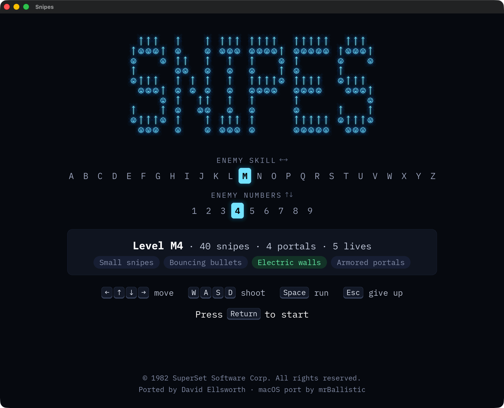
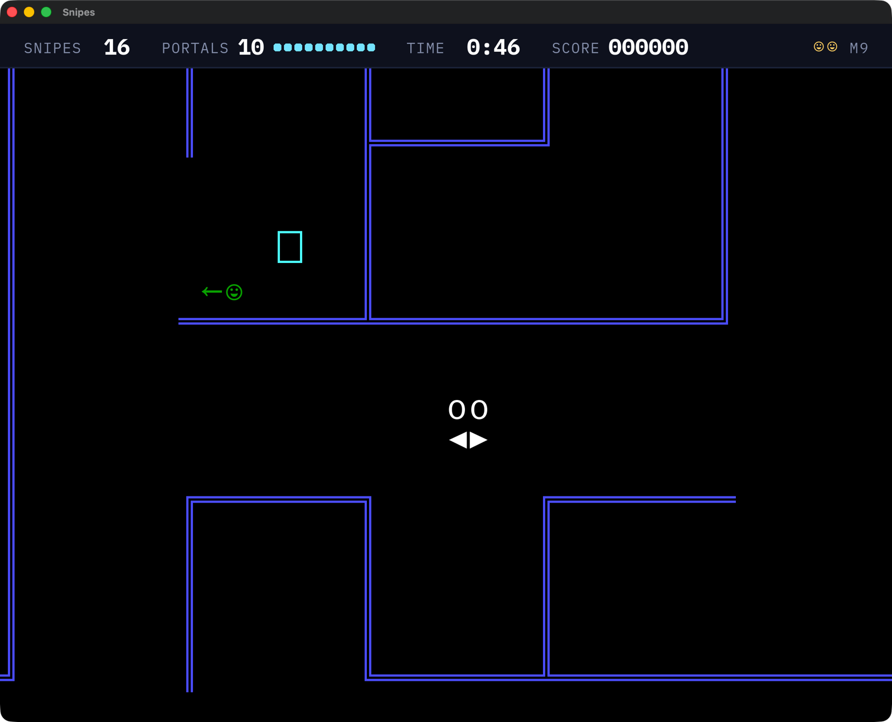

# Snipes

This is a modern port of the classic 1982 text-mode game Snipes. The code has been reverse-engineered from the original DOS executable, and has 100% identical game logic. 

For more information, see the [vogons.org forum thread](https://www.vogons.org/viewtopic.php?f=7&t=49073).

This is a fork of [Davidebyzero/Snipes](https://github.com/Davidebyzero/Snipes) that adds a native macOS app. It also:

- replaces the text title screen with a graphical start screen that explains the controls and what each level means
- replaces the three-row status line with a slim bar showing snipes and portals left, time and score
- renders at full Retina resolution
- runs the window and event loop on the main thread, which macOS requires
- falls back to a system font if `SnipesConsole.ttf` is missing
- opens the window at two-thirds of the screen height instead of full height

The game logic is unchanged, so replays recorded with the original port still play back identically.

<p align="center">
  
  
</p>

### Download for macOS

**[Download the latest release](https://github.com/mrballistic/Snipes/releases/latest)**, unzip it, and drag `Snipes.app` to your Applications folder.

- It's signed with a Developer ID and notarized by Apple, so it opens without a Gatekeeper warning.
- It's self-contained: SDL and the original font are bundled, so you don't need Homebrew.
- It requires an Apple Silicon Mac.
- Replays are saved to `~/Library/Application Support/Snipes`.

To build it yourself, see [macOS app bundle](#macos-app-bundle) below.

### Playing

On the start screen, pick a level and press Return. A level is a letter and a number, such as `M4`:

- **The letter (A–Z) sets how dangerous the snipes are:** how well they aim, whether small snipes appear, whether bullets bounce off walls, whether walls are electrified (M and up), and whether portals shrug off your shots (W and up).
- **The number (1–9) sets how many you face:** from 10 snipes and 3 portals with 5 lives, up to 150 snipes and 10 portals with 2 lives.

Use ← → and ↑ ↓ to move through the strips, or type the level (for example `b3`). The card below them spells out what the level means. The start screen remembers the last level you played.

In the game, the arrow keys move and W A S D shoot (X also shoots down). Hold Space to move faster, though you can’t shoot while it’s held. Esc gives up the current game. F1 turns sound on and off, and F2 turns the shooting sound on and off.

### Building

#### Dependencies

SDL builds require the SDL2 and SDL2_ttf libraries.

On startup, the SDL build will attempt to load a custom font, which can be obtained separately from [here](http://kingbird.myphotos.cc/ee22d44076adb8a34d8e20df4be3730a/SnipesConsole.ttf).

#### With Visual Studio

1. Copy `src/config-sample.h` to `src/config.h` (and edit as/if desired)
2. Open and build the Visual Studio solution file (`Sniper.sln`).
   The Visual Studio project file has configurations targeting SDL and Windows console graphics.

#### With GNU Make

1. (Optional) Copy `src/config-sample.h` to `src/config.h`, and edit as desired
2. Run `make` to compile an SDL build.

For Arch Linux, you can use the [snipes-git](https://aur.archlinux.org/packages/snipes-git/) AUR package.

#### macOS app bundle

This is how the release build is made.

1. Install the dependencies: `brew install sdl2 sdl3 sdl2_ttf`
2. Put `SnipesConsole.ttf` in the repository root to bundle it. The app icon is `art/Icon.icon`, an Icon Composer file; `art/` also holds its source artwork. The start screen and status bar use IBM Plex Mono, from `fonts/` (SIL Open Font License, see `fonts/IBMPlexMono-LICENSE.txt`).
3. Run `scripts/make-macos-app.sh`. It builds the game, bundles the libraries, signs everything with your first "Developer ID Application" identity, and writes `dist/Snipes.app` plus a zip of it.

To notarize as well, store your Apple credentials once, then pass the profile name:

```
xcrun notarytool store-credentials snipes-notary --apple-id <apple-id> --team-id <team-id>
NOTARY_PROFILE=snipes-notary scripts/make-macos-app.sh
```

The script header lists its other options, such as `SIGN_IDENTITY` and `BUNDLE_ID`.

To refresh the screenshots above, build the app, then run `scripts/capture-screenshots.sh`. It types into the game window for about a minute, so leave the keyboard alone while it runs.

#### Tests

`make test` builds and runs the unit tests for the level descriptions, start-screen keys, saved level and time formatting.

### Replay recording

This version automatically records replay files of played games. Replay files have a `.SnipesGame` file extension. They're saved to the current directory, or to `~/Library/Application Support/Snipes` when you run the macOS app.

To play back a replay file, pass it as the first argument to the game program, e.g.:

```
$ ./snipes "2016-07-08 09.10.11.SnipesGame"
```

### License

As this is a reverse-engineered port, copyright is retained by the original authors of Snipes.

This reverse-engineered source code is released with the original authors' permission.
